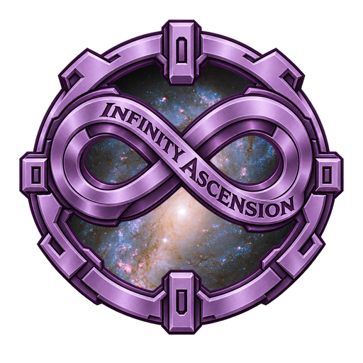

# GregTech Infinity Ascension

**GregTech for Minecraft 1.20.1 where the factory is the star:** 
megafactories, real industrial chemistry and long production lines.

[Download](https://github.com/GTInfinityAscension/GregTech-Infinity-Ascension/releases) · [Discord](https://discord.gg/TW5vugknk5) · [Report a bug](https://github.com/GTInfinityAscension/GregTech-Infinity-Ascension/issues/new/choose) · [Developer docs](https://gtinfinityascension.github.io/GTIA-Dev-Doc/)

> **Early development.** Builds are for testers: Start → Steam → LV → MV → HV is playable with the quest book, from the first log to the Moon.

## What makes it different

- **Grind is solved with more factory**, never with more clicking. Large machines, wireless power and AE2 are part of the main path.
- **Real chemistry, no PhD:** chlor-alkali, Bayer + Hall-Héroult, Haber-Bosch, Contact process and more. GregTech's one-step shortcuts are removed, so each base chemical comes from its real plant.
- **Lines get longer every tier**, from 2–3 steps in Steam to 10+ from IV on.
- **Every quest is reachable:** a checker reads the pack's real recipes and fails the build if a quest asks for something you can't make yet.

## Links

| Play | Contribute |
| --- | --- |
| 📦 [Releases (client and server)](https://github.com/GTInfinityAscension/GregTech-Infinity-Ascension/releases) | 🐞 [Open a new issue](https://github.com/GTInfinityAscension/GregTech-Infinity-Ascension/issues/new/choose) |
| ☀️ [Nightly build](https://github.com/GTInfinityAscension/GregTech-Infinity-Ascension/releases/tag/nightly) | 📱 [Open a new issue (mobile edition)](https://github.com/GTInfinityAscension/GregTech-Infinity-Ascension/issues/new?template=mobile_bug.yml) |
| 📱 [Play on Android](https://github.com/GTInfinityAscension/GregTech-Infinity-Ascension/blob/main/docs/MOBILE.md) | 🧹 [All open issues](https://github.com/issues?q=is%3Aopen+is%3Aissue+org%3AGTInfinityAscension) |
| 🗺️ [Roadmap](https://github.com/GTInfinityAscension/GregTech-Infinity-Ascension/blob/main/ROADMAP.md) | 🛠️ [All open pull requests](https://github.com/pulls?q=is%3Aopen+is%3Apr+org%3AGTInfinityAscension) |
| 📖 [GTNA wiki](https://gtinfinityascension.github.io/GregTech-Nexus-Addon/) | 📘 [Contribution guidelines](https://github.com/GTInfinityAscension/.github/blob/main/CONTRIBUTING.md) |
| 💬 [Discord](https://discord.gg/TW5vugknk5) | 📗 [Developer docs](https://gtinfinityascension.github.io/GTIA-Dev-Doc/) |
| 🖥️ [Server downloads](https://github.com/GTInfinityAscension/GregTech-Infinity-Ascension/releases/latest) | 🪶 [Maven](https://github.com/GTInfinityAscension/maven) |
| | 📜 [Code of Conduct](https://github.com/GTInfinityAscension/.github/blob/main/CODE_OF_CONDUCT.md) · 🤖 [AI policy](https://github.com/GTInfinityAscension/.github/blob/main/AI_POLICY.md) |

## Projects

**The pack**

| Repository | What it is |
| --- | --- |
| [GregTech-Infinity-Ascension](https://github.com/GTInfinityAscension/GregTech-Infinity-Ascension) | The modpack: configs, KubeJS, quests, manifest and release builds |

**Mods** (Forge 1.20.1)

| Repository | What it is |
| --- | --- |
| [GTIACore](https://github.com/GTInfinityAscension/GTIACore) | The pack's core mod: steam-era machines, chemistry lines and pack rules |
| [GregTech-Nexus-Addon](https://github.com/GTInfinityAscension/GregTech-Nexus-Addon) | GTNA: large machines, the Nexus energy network and endgame multiblocks |
| [Agronomica](https://github.com/GTInfinityAscension/Agronomica) | Industrial crop breeding: NPK soil, climate, metal crops and phytomining (early development) |
| [AscensionOptimizer](https://github.com/GTInfinityAscension/AscensionOptimizer) | Measured performance fixes for large modpacks; works in any Forge 1.20.1 pack |
| [GTIA-Lib](https://github.com/GTInfinityAscension/GTIA-Lib) | Shared library of the GTIA mods: text in three languages, tooltips, multiblock modules, GameTest kit |

**Infrastructure**

| Repository | What it is |
| --- | --- |
| [GTIA-Dev-Doc](https://github.com/GTInfinityAscension/GTIA-Dev-Doc) | Developer documentation: vision, tiers, systems, approved decisions, setup |
| [maven](https://github.com/GTInfinityAscension/maven) | Maven repository for the org's mods, synced from releases |
| [.github](https://github.com/GTInfinityAscension/.github) | This profile, org policies and issue/PR templates |
